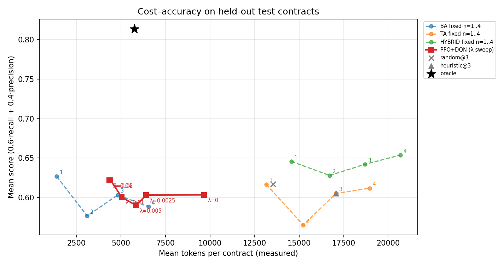

# Offline RL evaluation on real cached audits

- Test contracts: **40** {'easy': 12, 'medium': 19, 'hard': 9} (held-out split); policies trained on **34** train-pool contracts.
- LLM: `openai/gpt-oss-120b`; max rounds 4; λ = 0.005 (utility = score − λ·tokens/1000); seeds [0, 1, 2, 3, 4]; 10,000 bootstrap resamples.

## Headline

- Best fixed configuration (chosen on train): **HYBRID@1**
- PPO+DQN vs best fixed: score -0.056, tokens -59.9%
- PPO+DQN vs HYBRID@3 (base system's most thorough mode): score -0.052, tokens -68.8%
- Oracle gap closed (utility): **-0.058** (0 = best fixed, 1 = per-contract oracle)

## Proposed and baselines

| Method | Score [95% CI] | Precision | Recall | Tokens | Rounds | Utility [95% CI] | Seed SD |
|---|---|---|---|---|---|---|---|
| random@3 | 0.617 [0.520, 0.707] | 0.405 | 0.758 | 13,537 | 3.00 | 0.549 [0.452, 0.642] | – |
| heuristic@3 | 0.605 [0.489, 0.714] | 0.388 | 0.750 | 17,077 | 3.00 | 0.520 [0.404, 0.628] | – |
| PPO+DQN | 0.590 [0.467, 0.709] | 0.448 | 0.685 | 5,839 | 2.92 | 0.561 [0.433, 0.678] | ±0.022 |
| best-fixed-mode+DQN | 0.603 [0.479, 0.723] | 0.481 | 0.685 | 4,930 | 3.00 | 0.579 [0.450, 0.701] | ±0.022 |
| classifier+DQN | 0.603 [0.479, 0.722] | 0.481 | 0.685 | 4,930 | 3.00 | 0.579 [0.451, 0.703] | ±0.022 |
| linucb+DQN | 0.631 [0.525, 0.733] | 0.446 | 0.755 | 8,951 | 2.54 | 0.587 [0.477, 0.687] | ±0.029 |

## Ablations

| Method | Score [95% CI] | Precision | Recall | Tokens | Rounds | Utility [95% CI] | Seed SD |
|---|---|---|---|---|---|---|---|
| PPO+DQN | 0.590 [0.467, 0.709] | 0.448 | 0.685 | 5,839 | 2.92 | 0.561 [0.433, 0.678] | ±0.022 |
| PPO@3 (no DQN) | 0.642 [0.535, 0.740] | 0.421 | 0.790 | 10,801 | 3.00 | 0.588 [0.483, 0.686] | ±0.018 |
| random+DQN (no PPO) | 0.629 [0.540, 0.711] | 0.400 | 0.782 | 12,387 | 2.43 | 0.567 [0.476, 0.651] | ±0.010 |
| PPO+DQN w/o convergence feats | 0.619 [0.499, 0.733] | 0.469 | 0.720 | 4,601 | 2.15 | 0.596 [0.475, 0.710] | ±0.024 |
| PPO+DQN w/o v2 features | 0.588 [0.464, 0.709] | 0.449 | 0.680 | 5,556 | 2.80 | 0.560 [0.437, 0.678] | ±0.009 |

## Fixed configurations

| Method | Score [95% CI] | Precision | Recall | Tokens | Rounds | Utility [95% CI] | Seed SD |
|---|---|---|---|---|---|---|---|
| BA@1 | 0.627 [0.501, 0.747] | 0.479 | 0.725 | 1,400 | 1.00 | 0.620 [0.487, 0.739] | – |
| BA@2 | 0.577 [0.448, 0.698] | 0.429 | 0.675 | 3,107 | 2.00 | 0.561 [0.432, 0.684] | – |
| BA@3 | 0.603 [0.475, 0.728] | 0.458 | 0.700 | 4,824 | 3.00 | 0.579 [0.452, 0.701] | – |
| BA@4 | 0.588 [0.454, 0.714] | 0.458 | 0.675 | 6,549 | 4.00 | 0.556 [0.421, 0.684] | – |
| TA@1 | 0.617 [0.519, 0.700] | 0.305 | 0.825 | 13,163 | 1.00 | 0.551 [0.454, 0.636] | – |
| TA@2 | 0.565 [0.442, 0.680] | 0.363 | 0.700 | 15,228 | 2.00 | 0.489 [0.371, 0.604] | – |
| TA@3 | 0.605 [0.488, 0.715] | 0.388 | 0.750 | 17,077 | 3.00 | 0.520 [0.404, 0.629] | – |
| TA@4 | 0.612 [0.495, 0.723] | 0.405 | 0.750 | 18,952 | 4.00 | 0.517 [0.400, 0.628] | – |
| HYBRID@1 | 0.646 [0.561, 0.717] | 0.302 | 0.875 | 14,562 | 1.00 | 0.573 [0.487, 0.645] | – |
| HYBRID@2 | 0.628 [0.530, 0.716] | 0.333 | 0.825 | 16,714 | 2.00 | 0.544 [0.445, 0.635] | – |
| HYBRID@3 | 0.642 [0.542, 0.733] | 0.368 | 0.825 | 18,709 | 3.00 | 0.549 [0.448, 0.642] | – |
| HYBRID@4 | 0.654 [0.548, 0.748] | 0.397 | 0.825 | 20,683 | 4.00 | 0.550 [0.447, 0.650] | – |

## Oracles (upper bounds)

| Method | Score [95% CI] | Precision | Recall | Tokens | Rounds | Utility [95% CI] | Seed SD |
|---|---|---|---|---|---|---|---|
| oracle-mode+DQN | 0.755 [0.658, 0.842] | 0.582 | 0.870 | 7,641 | 2.79 | 0.717 [0.617, 0.804] | ±0.010 |
| oracle-mode@3 | 0.729 [0.622, 0.825] | 0.547 | 0.850 | 7,804 | 3.00 | 0.690 [0.587, 0.784] | – |
| oracle (mode+round) | 0.814 [0.716, 0.897] | 0.684 | 0.900 | 5,754 | 1.62 | 0.785 [0.687, 0.870] | – |

## Paired bootstrap: PPO+DQN minus method

| Method | ΔUtility [95% CI] | p | ΔScore [95% CI] | p | ΔTokens |
|---|---|---|---|---|---|
| BA@3 | -0.018 [-0.100, +0.062] | 0.679 | -0.013 [-0.092, +0.068] | 0.627 | +1,015 |
| TA@3 | +0.041 [-0.065, +0.145] | 0.220 | -0.015 [-0.122, +0.095] | 0.607 | -11,238 |
| HYBRID@3 | +0.012 [-0.106, +0.129] | 0.410 | -0.052 [-0.172, +0.065] | 0.813 | -12,870 |
| random@3 | +0.012 [-0.069, +0.093] | 0.390 | -0.027 [-0.107, +0.055] | 0.740 | -7,698 |
| heuristic@3 | +0.041 [-0.067, +0.146] | 0.232 | -0.015 [-0.123, +0.091] | 0.606 | -11,238 |
| PPO@3 (no DQN) | -0.028 [-0.114, +0.051] | 0.743 | -0.052 [-0.138, +0.030] | 0.894 | -4,962 |
| random+DQN (no PPO) | -0.006 [-0.076, +0.059] | 0.560 | -0.039 [-0.109, +0.026] | 0.870 | -6,548 |
| PPO+DQN w/o convergence feats | -0.036 [-0.069, -0.008] | 0.995 | -0.029 [-0.063, -0.002] | 0.985 | +1,238 |
| PPO+DQN w/o v2 features | +0.001 [-0.021, +0.023] | 0.461 | +0.002 [-0.018, +0.023] | 0.425 | +283 |
| best-fixed-mode+DQN | -0.018 [-0.088, +0.040] | 0.715 | -0.013 [-0.082, +0.047] | 0.686 | +909 |
| classifier+DQN | -0.018 [-0.088, +0.042] | 0.717 | -0.013 [-0.080, +0.047] | 0.676 | +909 |
| linucb+DQN | -0.026 [-0.101, +0.040] | 0.763 | -0.041 [-0.113, +0.022] | 0.891 | -3,112 |
| oracle-mode+DQN | -0.156 [-0.245, -0.077] | 1.000 | -0.165 [-0.256, -0.084] | 1.000 | -1,802 |
| oracle-mode@3 | -0.129 [-0.224, -0.038] | 0.998 | -0.139 [-0.239, -0.043] | 0.998 | -1,965 |
| oracle (mode+round) | -0.224 [-0.321, -0.138] | 1.000 | -0.224 [-0.328, -0.132] | 1.000 | +85 |

p = one-sided bootstrap probability that PPO+DQN is not better (small = PPO+DQN better).

## DQN stopping vs fixed rounds (per mode)

| Mode | DQN score | DQN tokens | mean stop round | fixed@1 score / tokens | fixed@2 score / tokens | fixed@3 score / tokens | fixed@4 score / tokens |
|---|---|---|---|---|---|---|---|
| BA | 0.603 | 4,930 | 3.0 | 0.627 / 1,400 | 0.577 / 3,107 | 0.603 / 4,824 | 0.588 / 6,549 |
| TA | 0.617 | 15,857 | 2.37 | 0.617 / 13,163 | 0.565 / 15,228 | 0.605 / 17,077 | 0.612 / 18,952 |
| HYBRID | 0.667 | 16,375 | 1.91 | 0.646 / 14,562 | 0.628 / 16,714 | 0.642 / 18,709 | 0.654 / 20,683 |

## λ sweep (cost–accuracy frontier)

| λ | PPO+DQN score | tokens | modes | best fixed at ≤ same tokens | its score | fixed configs dominated |
|---|---|---|---|---|---|---|
| 0 | 0.603 | 9,666 | {'BA': 22.2, 'TA': 6.0, 'HYBRID': 11.8} | BA@1 | 0.627 | 1 |
| 0.0025 | 0.603 | 6,417 | {'BA': 33.4, 'TA': 4.0, 'HYBRID': 2.6} | BA@1 | 0.627 | 2 |
| 0.005 | 0.590 | 5,839 | {'BA': 36.0, 'TA': 4.0, 'HYBRID': 0} | BA@1 | 0.627 | 2 |
| 0.01 | 0.601 | 5,043 | {'BA': 36.4, 'TA': 3.6, 'HYBRID': 0} | BA@1 | 0.627 | 2 |
| 0.02 | 0.622 | 4,414 | {'BA': 37.0, 'TA': 3.0, 'HYBRID': 0} | BA@1 | 0.627 | 6 |
| 0.04 | 0.622 | 4,355 | {'BA': 37.0, 'TA': 3.0, 'HYBRID': 0} | BA@1 | 0.627 | 6 |

